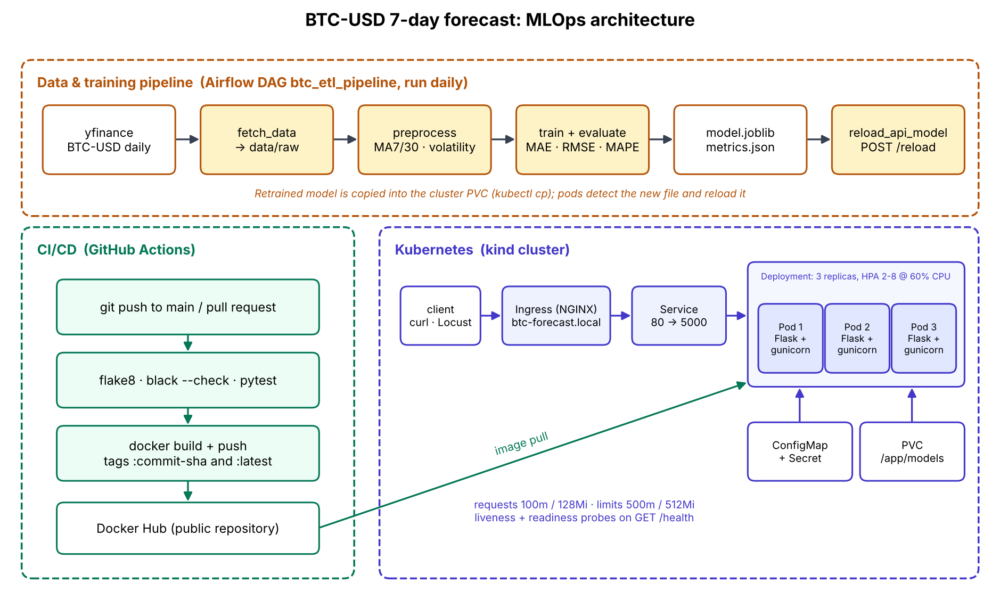

# BTC-USD 7-day forecast: production MLOps pipeline

Flask API (gunicorn) serving a 7-day Bitcoin closing-price forecast, retrained daily by an
Airflow DAG, built and pushed by GitHub Actions, and deployed on Kubernetes (kind).



| Path | Purpose |
| --- | --- |
| `app/app.py` | REST API: `GET /health`, `POST /predict`, `GET /metrics` (plus `POST /reload`) |
| `app/Dockerfile` | Multi-stage, non-root image for the API (build from the repo root) |
| `src/etl_fetch.py` | Pull BTC-USD daily data (yfinance, CoinGecko fallback) into `data/raw/` |
| `src/preprocess.py`, `src/features.py` | Cleaning, 7/30-day moving averages, volatility, lag features |
| `src/train_forecast.py` | Train + evaluate (MAE/RMSE/MAPE on the latest 7 days), save `model.joblib` |
| `dags/btc_etl_pipeline.py` | Airflow DAG: fetch, preprocess, train/evaluate, quality gate, reload API |
| `kubeflow/btc_kfp_pipeline.py` | KFP v2 pipeline (compiled to `btc_kfp_pipeline.yaml`) |
| `.github/workflows/ci_cd.yml` | flake8, black, pytest; then build and push the image to Docker Hub |
| `k8s/` | ConfigMap/Secret, PVC, Deployment, Services, HPA, Ingress, kind config |
| `docker-compose.yml` | Local API + Postgres + Airflow |
| `load/locustfile.py` | Load test used to trigger the HPA |

## Quick start

```bash
pip install -r requirements-dev.txt
python src/etl_fetch.py                  # data/raw/btc_usd.csv
python src/train_forecast.py             # models/model.joblib + metrics.json
pytest -v
cd app && gunicorn --bind 0.0.0.0:5000 app:app
curl -X POST localhost:5000/predict -H 'Content-Type: application/json' -d '{"forecast_days": 7}'
```

Docker image: `docker build -f app/Dockerfile -t btc-forecast-api .`
